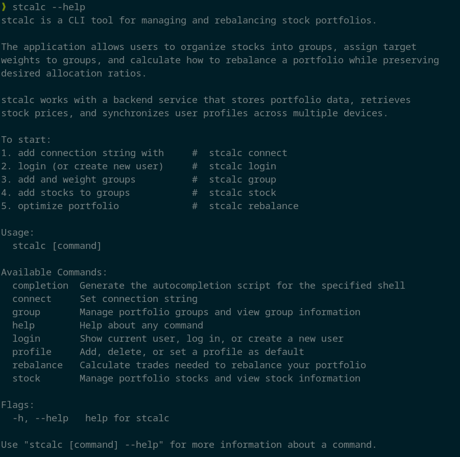
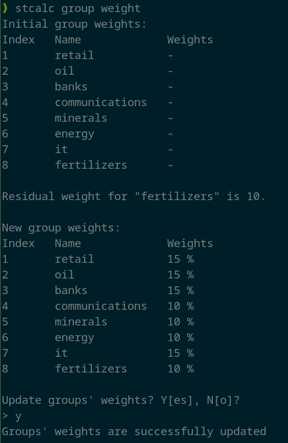
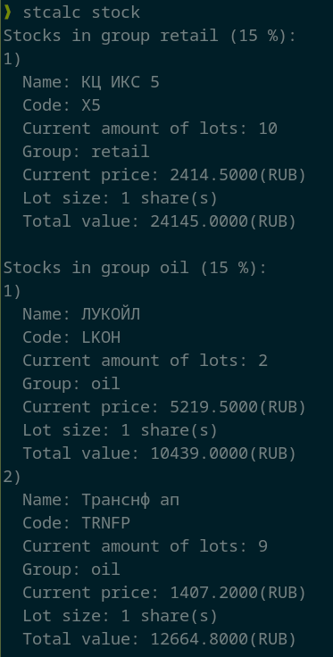
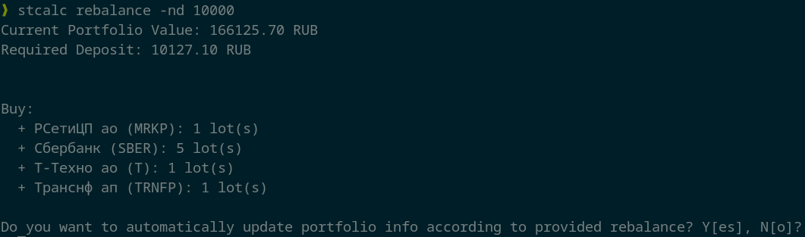

## Running the Project

### Frontend development

To run the Go server, PostgreSQL, migrations, and Vite together for development, put `DATABASE_USER` and `DATABASE_PASSWORD` in the existing root `.env` file or export them in your shell, then run:

```sh
./dev.sh
```

Open `http://localhost:5173`. Vite proxies `/api` to the backend inside the Compose network; the debug backend is also available on `http://localhost:8989`. Set `DEV_FRONTEND_PORT` or `DEV_BACKEND_PORT` to change the host ports. Frontend source changes reload automatically; rerun `./dev.sh` to rebuild after Go changes. The script runs in the foreground; Ctrl+C stops the containers without deleting data.

This stack uses the separate `stocks-calculator-dev` Compose project and its own PostgreSQL volume. It applies the existing up migrations to that development database. Its local database volume is persistent; it is not the volume used by the default Compose project. To stop it separately without removing data, run `docker compose -p stocks-calculator-dev -f compose.dev.yaml down`. Do not use `-v` unless you intend to delete the development database. The stack is for local development, not production; it uses the project's existing server configuration.

Run `npm install` and `npm run dev` in `frontend/`. The Vite development and preview servers forward `/api/*` to `http://127.0.0.1:8989/*` by default. Set `API_PROXY_TARGET` when starting Vite if the Go server uses another address, for example `API_PROXY_TARGET=http://127.0.0.1:9000 npm run dev`. The address is resolved by the machine running Vite, including when the browser is on a phone.

For production, configure a same-origin reverse proxy to forward `/api/*` to the Go server with the `/api` prefix removed, and serve the application over HTTPS. Vite's development proxy is not a production proxy. Refresh tokens are stored in browser local storage; access tokens remain in memory.

Using Docker Compose

```
docker compose up --build
```

Running CLI
```
go install cmd/cli/stcalc.go
```
then use stcalc in your terminal

# Stock Portfolio Rebalancer

A Go-based stock portfolio management and rebalancing system with a CLI client and backend service.

The project helps maintain target portfolio allocations across stock groups and individual stocks. It calculates how to rebalance a portfolio by suggesting which stocks to buy or sell while preserving predefined ratios.

## Features

* Portfolio management with multiple user profiles
* Group-based portfolio organization (e.g. Tech, Energy, Finance)
* Adjustable weight ratios between groups
* Portfolio rebalancing calculations
* CLI application for user interaction
* Backend API service
* Database-backed persistence
* Multi-device access through account system
* Docker support
* Swagger API documentation

## How Rebalancing Works

The application uses weighted allocation rules:

1. Portfolio value is divided according to group weights
2. Each group allocation is distributed equally between stocks inside that group
3. The system compares target allocations with current holdings
4. Buy/sell recommendations are generated to rebalance the portfolio

Example:

Tech group: 60%
Energy group: 40%

If Tech contains 3 stocks, each stock receives 20% target allocation.

## Project Architecture

The project is divided into two independent parts:

1. CLI Application

The CLI is the main user interface.

Responsibilities:

* User authentication
* Managing profiles
* Managing groups
* Managing stocks
* Triggering rebalance operations
* Connecting to backend service

2. Backend Service

The backend stores portfolio data and provides stock-related functionality.

Responsibilities:

* User management
* Data persistence
* Authentication/token handling
* Portfolio calculations
* Stock price retrieval

This separation allows:

Multi-device synchronization
Centralized data storage
Multiple accounts
Future web/mobile clients

## Tech Stack

* Language: Go
* Database: PostgreSQL, SQL-based migrations (used with migrate golang tool)
* Authentication: Token-based JWT auth
* Containerization: Docker & Docker Compose
* Endpoints documentation: Swagger (generated with swaggo/swag golang tool)
* Testing tools: testify and mockery

## Project Structure
```
.
├── cmd/
│   ├── cli/                 # CLI entrypoint
│   └── server/              # Backend server entrypoint
│
├── internal/
│   ├── cli/                 # CLI implementation
│   ├── model/               # Shared models
│   └── server/              # Backend logic
│
├── migrations/              # Database migrations
├── docs/                    # Swagger documentation
├── mocks/                   # Test mocks
├── pkg/                     # Shared packages
├── compose.yaml             # Docker Compose configuration
├── Dockerfile
└── config.yaml
```

## Configuration

Server configuration is provided through:

config.yaml and .env

Default config:

config.yaml
```
max_connections: 100
jwt_key: dev_secret_key_do_not_use_in_production
jwt_expiration_time_min: 10
```

.env
```
DATABASE_USER=pguser
DATABASE_PASSWORD=1234
PORT=8989
```

## Swagger documentation is available in:
```
/docs
```

## Screenshots





